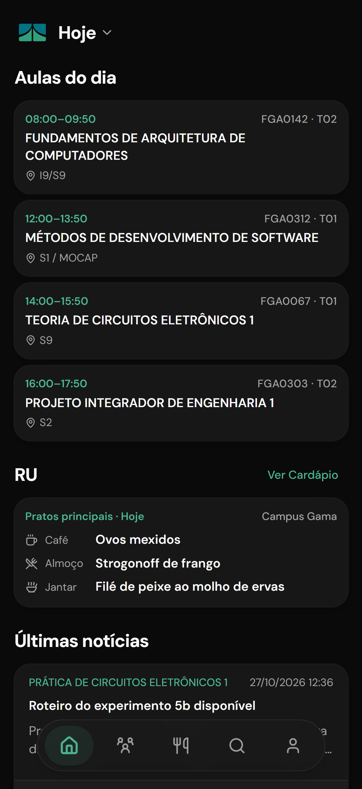
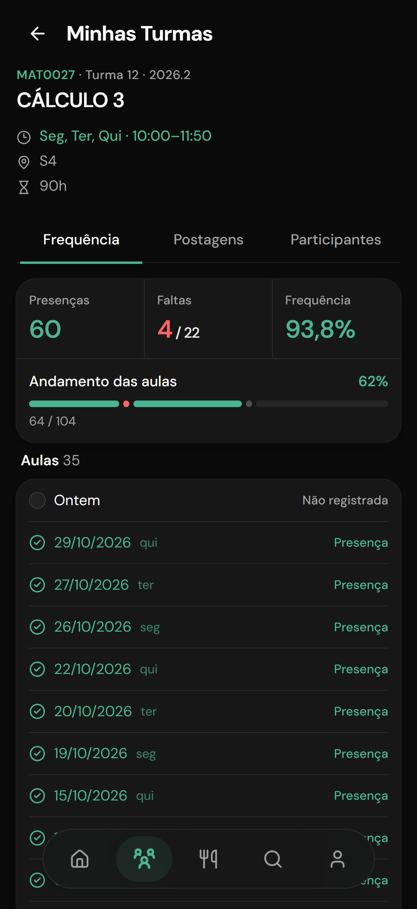
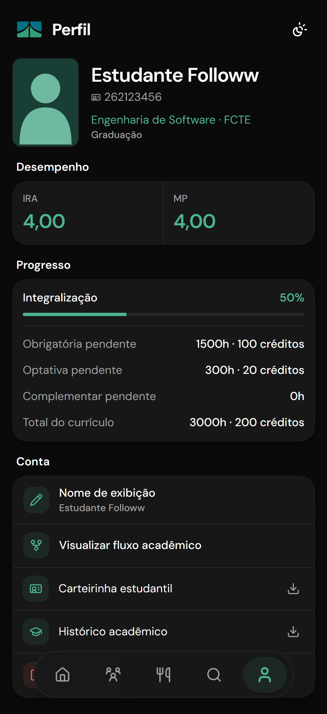
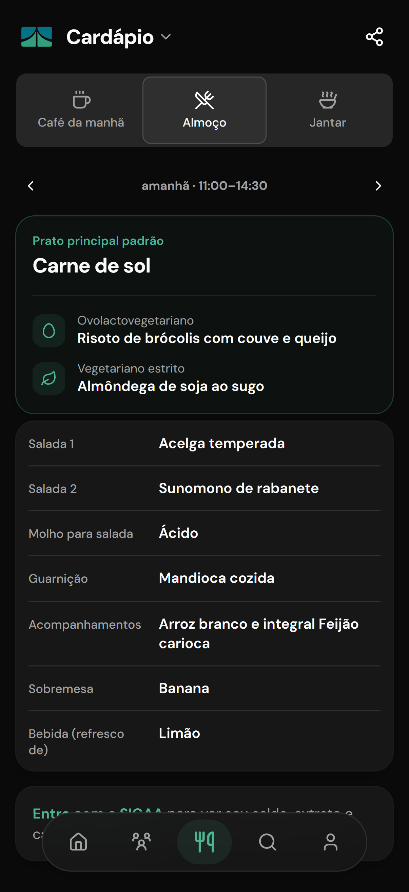
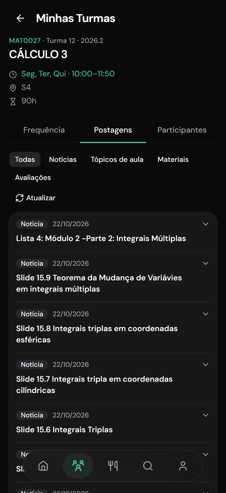
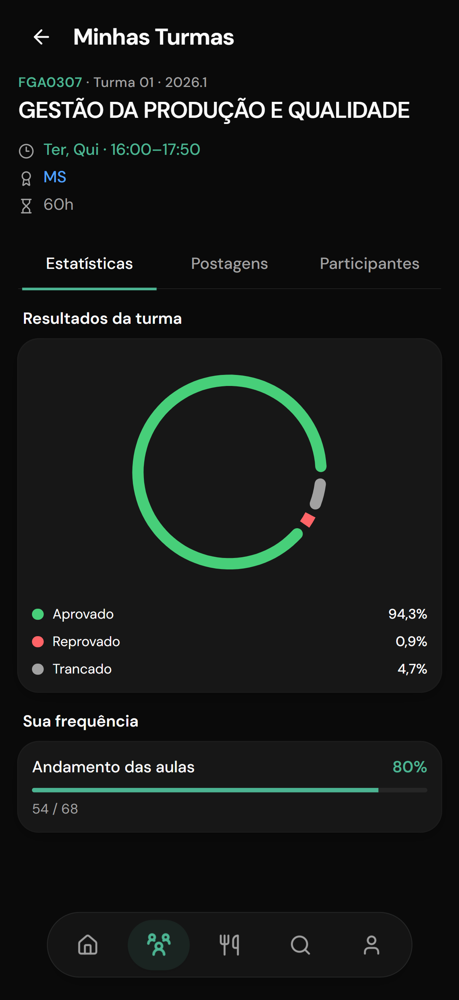

# Followw UnB

O Followw reúne o SIGAA e outros serviços da UnB em um aplicativo web para a rotina de estudantes. O
cardápio do RU, a busca e os fluxos de cursos são públicos. Para acompanhar seus dados acadêmicos,
você entra com a mesma matrícula e senha do SIGAA. Suas credenciais são criptografadas e ficam
salvas apenas no seu navegador. [Saiba mais](docs/segurança.md)

> O Followw é independente e não possui vínculo oficial com a UnB ou com o SIGAA.

[Acessar o Followw](https://followw.app/) · [Documentação](https://docs.followw.app/) ·
[Requisitos no Figma](https://www.figma.com/board/JqtNZhLBFlsVIbthMYOdzB/Requisitos-Followw)

## Funcionalidades

### Sem entrar na conta

- Consultar e compartilhar o cardápio do RU por campus e refeição, com opções vegetarianas.
- Buscar matérias, cursos e docentes; conferir horários, vagas, requisitos e perfis de docentes.
- Explorar o fluxo de um curso por semestre, carga horária, pré-requisitos e correquisitos.

### Depois de entrar com o SIGAA

- Ver as aulas do dia, seus horários e locais, as turmas de outros semestres e as notícias recentes.
- Consultar turmas, notas e postagens e simular a frequência sem alterar o SIGAA.
- Ver gráficos de aprovação, reprovação e trancamento em turmas concluídas.
- Ver recomendações pelo seu fluxo e montar uma grade semanal para baixar como imagem.
- Consultar saldo e extrato do RU e abrir a carteirinha com QR code.
- Ver índices e integralização no perfil e baixar histórico e carteirinha em PDF quando disponíveis.
- Reabrir páginas e dados consultados sem internet e instalar o Followw pelo navegador.

## Telas

<table>
  <thead>
    <tr><th align="center">Início</th><th align="center">Frequência</th><th align="center">Perfil</th></tr>
  </thead>
  <tbody>
    <tr>
      <td align="center"></td>
      <td align="center"></td>
      <td align="center"></td>
    </tr>
  </tbody>
  <tbody>
    <tr><td align="center"><strong>Cardápio RU</strong></td><td align="center"><strong>Postagens</strong></td><td align="center"><strong>Aprovações</strong></td></tr>
  </tbody>
  <tbody>
    <tr>
      <td align="center"></td>
      <td align="center"></td>
      <td align="center"></td>
    </tr>
  </tbody>
</table>

## Estrutura do projeto

```text
apps/
├── api/              API FastAPI, autenticação e cache
└── web/              aplicação web em TanStack Start
packages/
├── sigaa-client/     cliente assíncrono do SIGAA
└── unb-browser/      cliente dos serviços públicos da UnB
docs/                 documentação e notas de sprint
```

## Executar localmente

Instale [Python 3.14+](https://www.python.org/), [uv](https://docs.astral.sh/uv/),
[Bun](https://bun.sh/) e [Docker com Compose](https://docs.docker.com/compose/). Execute os comandos
na raiz do repositório, salvo quando indicado.

1. Instale as dependências e crie a configuração:

    ```sh
    uv sync
    cp .env.example .env
    ```

    O comando abaixo gera uma chave aleatória. Execute-o duas vezes e preencha `JWT_SECRET_KEY` e
    `RATE_LIMIT_SECRET_KEY` no `.env`, cada uma com um valor diferente:

    ```sh
    python -c "import secrets; print(secrets.token_urlsafe(32))"
    ```

2. Inicie os serviços, prepare o banco e execute a API:

    ```sh
    docker compose up -d
    uv run db-init
    uv run api
    ```

    A API fica em <http://localhost:8000> e sua documentação em <http://localhost:8000/docs>. O
    `db-init` cria as tabelas e carrega os dados públicos iniciais.

3. Em outro terminal, inicie a aplicação web:

    ```sh
    bun install
    cd apps/web
    bun dev
    ```

    Abra <http://localhost:3000>. Para acessar seus dados acadêmicos, entre com sua conta do SIGAA.

### Testes

Na raiz do repositório, execute os testes e as verificações Python:

```sh
uv run pytest
uv run ruff check .
uv run ruff format --check .
```

Para verificar a aplicação web:

```sh
bun install
cd packages/core && bun check && bun test
cd ../../apps/web && bun check && bun test && bun run build
```

## Contribuir

No momento, por conta das regras da matéria, não estamos aceitando PRs de contribuidores externos,
mas sinta-se à vontade para relatar problemas ou sugestões
[abrindo uma issue](https://github.com/unb-mds/2026-2-Followw/issues)

## Criadores

<table>
  <tbody>
  <tr>
    <td align="center" width="25%">
      <a href="https://github.com/eliabexp">
        <br>
        <sub><b>eliabe</b></sub>
      </a>
    </td>
    <td align="center" width="25%">
      <a href="https://github.com/SamukaToned">
        <br>
        <sub><b>Samuka</b></sub>
      </a>
    </td>
    <td align="center" width="25%">
      <a href="https://github.com/diegolxxz">
        <br>
        <sub><b>Diego</b></sub>
      </a>
    </td>
    <td align="center" width="25%">
      <a href="https://github.com/Mendezalv">
        <br>
        <sub><b>Kauã</b></sub>
      </a>
    </td>
  </tr>
  </tbody>
  <tbody>
  <tr>
    <td align="center" width="25%">
      <a href="https://github.com/ed9gaspar">
        <br>
        <sub><b>Gaspar</b></sub>
      </a>
    </td>
    <td align="center" width="25%">
      <a href="https://github.com/gabrielcrzojo">
        <br>
        <sub><b>Gabriel</b></sub>
      </a>
    </td>
    <td align="center" width="25%">
      <a href="https://github.com/ratatta-na-nite">
        <br>
        <sub><b>Galvão</b></sub>
      </a>
    </td>
  </tr>
  </tbody>
</table>

> Squad 5 da matéria Métodos de Desenvolvimento de Software, com a professora Carla Rocha.
