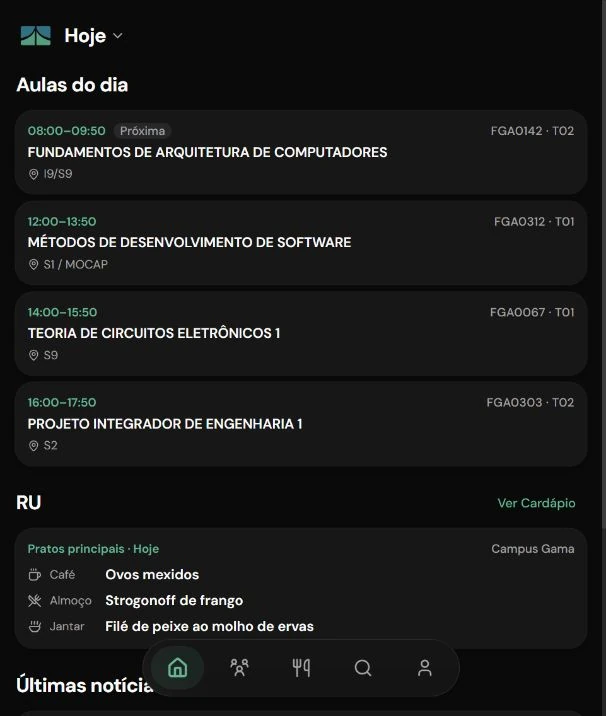
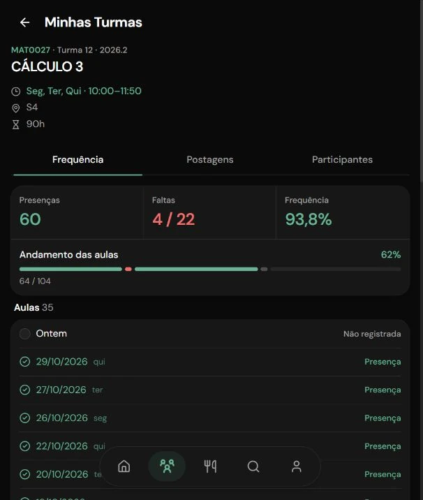
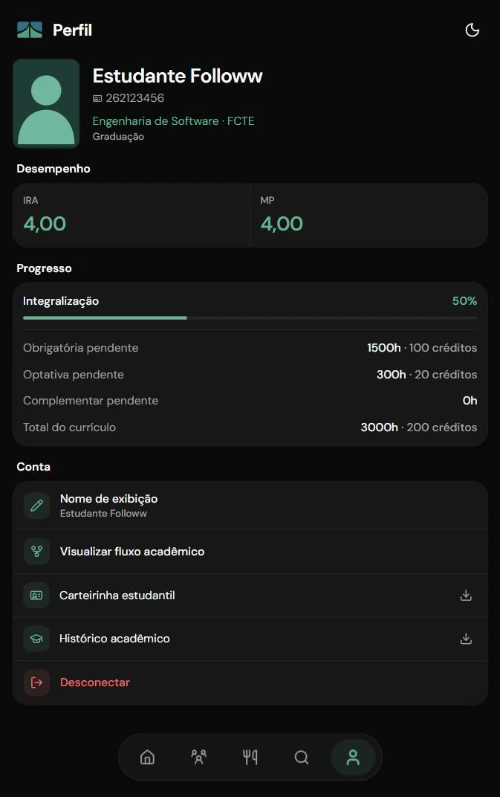
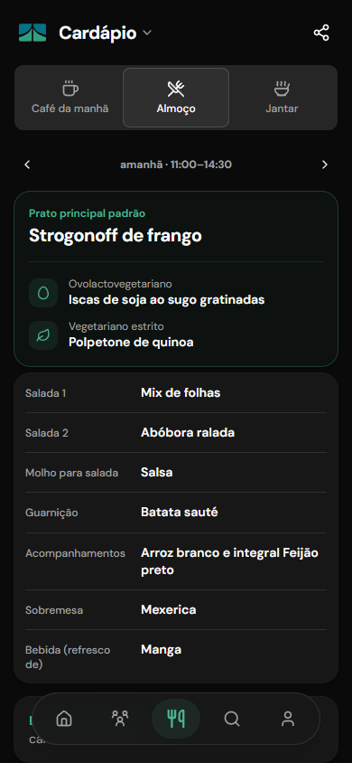
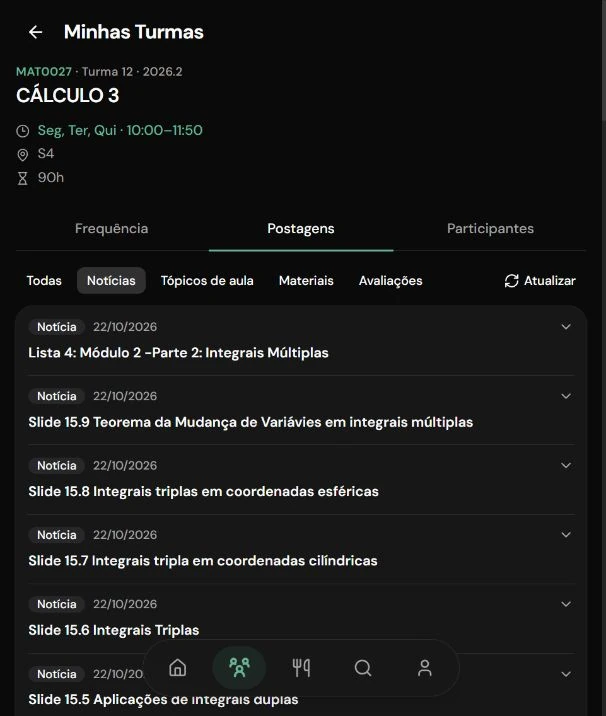
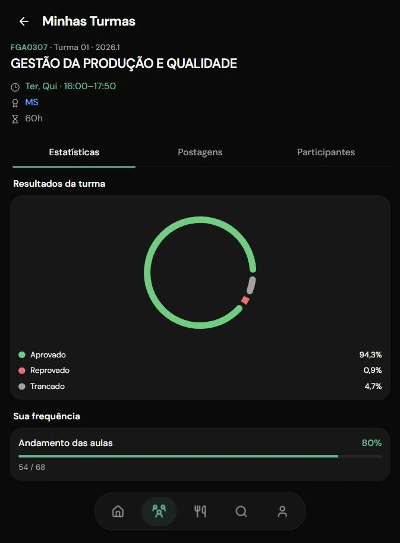

# Followw UnB

O Followw reúne o SIGAA e outros serviços da UnB em um aplicativo web para a rotina de estudantes.
O cardápio do RU, a busca e os fluxos de cursos são públicos. Para acompanhar seus dados acadêmicos,
você entra com a mesma matrícula e senha do SIGAA. A UnB valida o login; suas credenciais ficam
criptografadas no navegador. [Saiba mais](docs/segurança.md).

> Projeto independente, sem vínculo oficial com a UnB ou com o SIGAA.

[Abrir o Followw](https://followw.app/) · [Documentação](https://docs.followw.app/) · [Requisitos no Figma](https://www.figma.com/board/JqtNZhLBFlsVIbthMYOdzB/Requisitos-Followw)

## O que você pode fazer

### Sem entrar na conta

- Consultar e compartilhar o cardápio do RU por campus e refeição, com opções vegetarianas.
- Buscar matérias, cursos e docentes; conferir horários, vagas, requisitos e perfis de docentes.
- Explorar o fluxo de um curso por semestre, carga horária, pré-requisitos e correquisitos.

### Depois de entrar com o SIGAA

- Ver as aulas do dia, seus horários e locais, as turmas de outros semestres e as notícias recentes.
- Consultar turmas, notas e postagens e simular a frequência sem alterar o SIGAA.
- Ver gráficos de aprovação, reprovação e trancamento em turmas concluídas.
- Ver recomendações pelo seu fluxo e montar uma grade semanal para baixar como imagem.
- Consultar saldo e extrato do RU e abrir a carteirinha com QR code.
- Ver índices e integralização no perfil e baixar histórico e carteirinha em PDF quando disponíveis.
- Reabrir páginas e dados consultados sem internet e instalar o Followw pelo navegador.

## Telas

| Aulas do dia | Frequência | Perfil |
| --- | --- | --- |
|  |  |  |
| Cardápio do RU | Postagens | Aprovações da turma |
|  |  |  |

Nome, foto, matrícula e indicadores individuais nas capturas são ilustrativos.
[Ver todas as capturas](docs/assets/screenshots/).

## Como o projeto funciona

O front-end usa TanStack Start e consulta a API FastAPI em `/api`. A API usa o `sigaa-client` para
dados do SIGAA e o `unb-browser` para fontes públicas da UnB. PostgreSQL guarda o cache de dados;
QStash entrega os trabalhos de sincronização, e Redis ajuda a limitar requisições. Os dados já
consultados também ficam em cache no navegador para acesso offline.

O Followw não cria conta própria. O CAS da UnB valida o login, e a sessão fica em cookies cifrados no
navegador. A API não mantém uma sessão persistida no servidor nem grava a senha no banco. O
tratamento das credenciais está detalhado em [segurança](docs/segurança.md); o funcionamento offline,
em [modo offline](docs/offline.md).

## Estrutura do projeto

```text
apps/
├── api/              API FastAPI, autenticação e cache
└── web/              aplicação web em TanStack Start
packages/
├── sigaa-client/     cliente assíncrono do SIGAA
└── unb-browser/      cliente dos serviços públicos da UnB
docs/                 documentação e notas de sprint
```

## Executar localmente

Instale [Python 3.14+](https://www.python.org/), [uv](https://docs.astral.sh/uv/),
[Bun](https://bun.sh/) e [Docker com Compose](https://docs.docker.com/compose/).
Execute os comandos na raiz do repositório, salvo quando indicado.

1. Instale as dependências e crie a configuração:

   ```sh
   uv sync
   cp .env.example .env
   ```

   No PowerShell, use `Copy-Item .env.example .env`. No `.env`, defina `JWT_SECRET_KEY` com uma
   chave de pelo menos 32 caracteres. Para gerar uma chave:

   ```sh
   python -c "import secrets; print(secrets.token_urlsafe(32))"
   ```

2. Inicie os serviços, prepare o banco e execute a API:

   ```sh
   docker compose up -d
   uv run db-init
   uv run api
   ```

   A API fica em <http://localhost:8000> e sua documentação em <http://localhost:8000/docs>.
   O `db-init` cria as tabelas e carrega os dados públicos iniciais.

3. Em outro terminal, inicie a aplicação web:

   ```sh
   cd apps/web
   bun install
   bun dev
   ```

   Abra <http://localhost:3000>. Para acessar seus dados acadêmicos, entre com sua conta do SIGAA.

### Variáveis de ambiente

A API lê o `.env` da raiz. O [`.env.example`](.env.example) já traz os valores locais para banco,
QStash e Redis: para começar, preencha `JWT_SECRET_KEY`.

| Variável | Para que serve |
| --- | --- |
| `JWT_SECRET_KEY` | Obrigatória. Cifra os cookies de sessão e as credenciais dos jobs. |
| `DATABASE_URL` | Conexão com o PostgreSQL. |
| `PUBLIC_URL` e `QSTASH_*` | Entrega dos jobs de sincronização à API. |
| `UPSTASH_REDIS_REST_*` | Conexão com o Redis usado no limite de requisições. |
| `RATE_LIMIT_SECRET_KEY` | Opcional. Se usada, configure o mesmo valor na API e no processo `bun dev`. |
| `VITE_POSTHOG_KEY` | Opcional. Configure em `apps/web/.env` para habilitar analytics. |
| `TEST_REGISTRATION` e `TEST_PASSWORD` | Opcionais. Credenciais para testes manuais com o SIGAA. |

### Verificação

Na raiz do repositório, execute os testes e as verificações Python:

```sh
uv run pytest
uv run ruff check .
uv run ruff format --check .
```

Para verificar a aplicação web:

```sh
cd apps/web
bun check
bun test
bun run build
```

## Contribuir

Durante o semestre de Métodos de Desenvolvimento de Software (MDS), recebemos contribuições por
[issues](https://github.com/unb-mds/2026-2-Followw/issues). Use esse espaço para relatar problemas
ou sugerir melhorias. Nesse período, não aceitamos pull requests externos.

## Criadores

<table>
  <tr>
    <td align="center">
      <a href="https://github.com/eliabexp">
        <br>
        <sub><b>eliabe</b></sub>
      </a>
    </td>
    <td align="center">
      <a href="https://github.com/SamukaToned">
        <br>
        <sub><b>Samuka</b></sub>
      </a>
    </td>
    <td align="center">
      <a href="https://github.com/diegolxxz">
        <br>
        <sub><b>Diego</b></sub>
      </a>
    </td>
    <td align="center">
      <a href="https://github.com/Mendezalv">
        <br>
        <sub><b>Kauã Alves Mendes</b></sub>
      </a>
    </td>
  </tr>
  <tr>
    <td align="center">
      <a href="https://github.com/ed9gaspar">
        <br>
        <sub><b>Gaspar</b></sub>
      </a>
    </td>
    <td align="center">
      <a href="https://github.com/gabrielcrzojo">
        <br>
        <sub><b>Gabriel</b></sub>
      </a>
    </td>
    <td align="center">
      <a href="https://github.com/ratatta-na-nite">
        <br>
        <sub><b>Gabriel Galvão</b></sub>
      </a>
    </td>
  </tr>
</table>

> Squad 5 da matéria Métodos de Desenvolvimento de Software, com a professora Carla Rocha.
