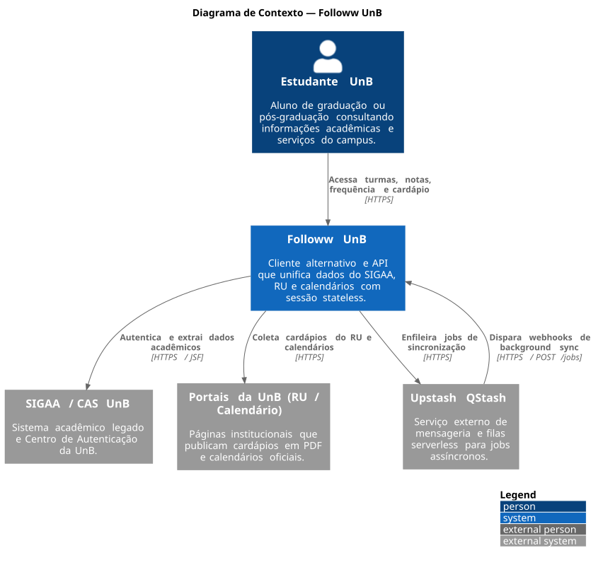
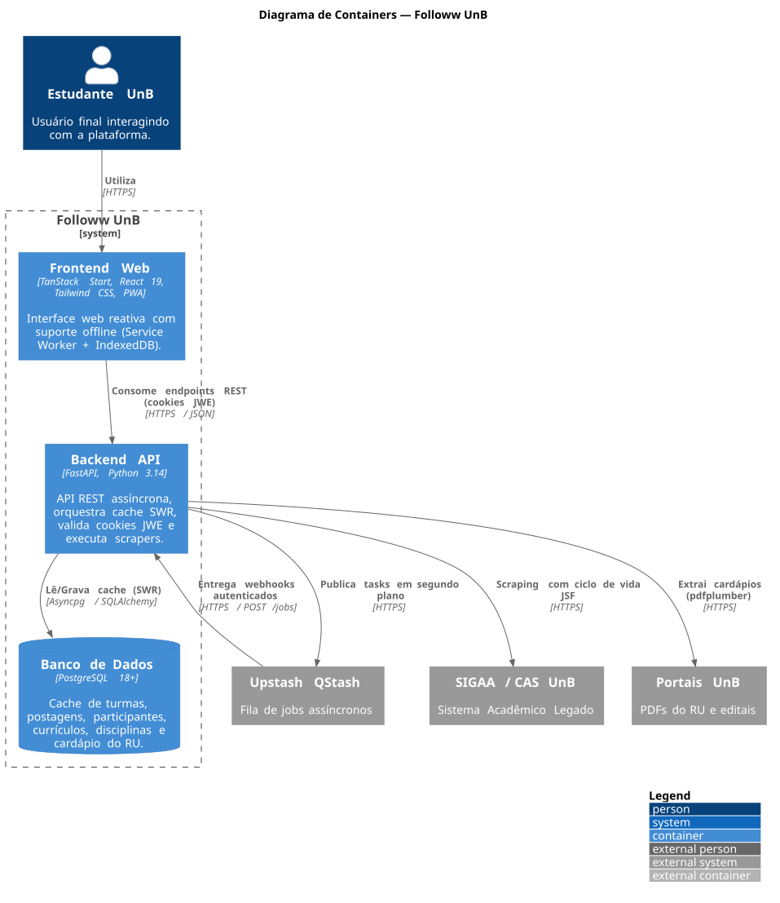
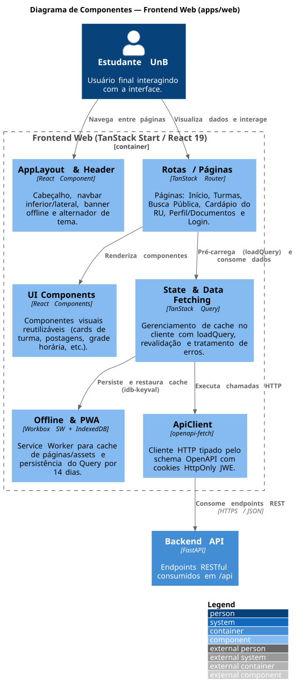
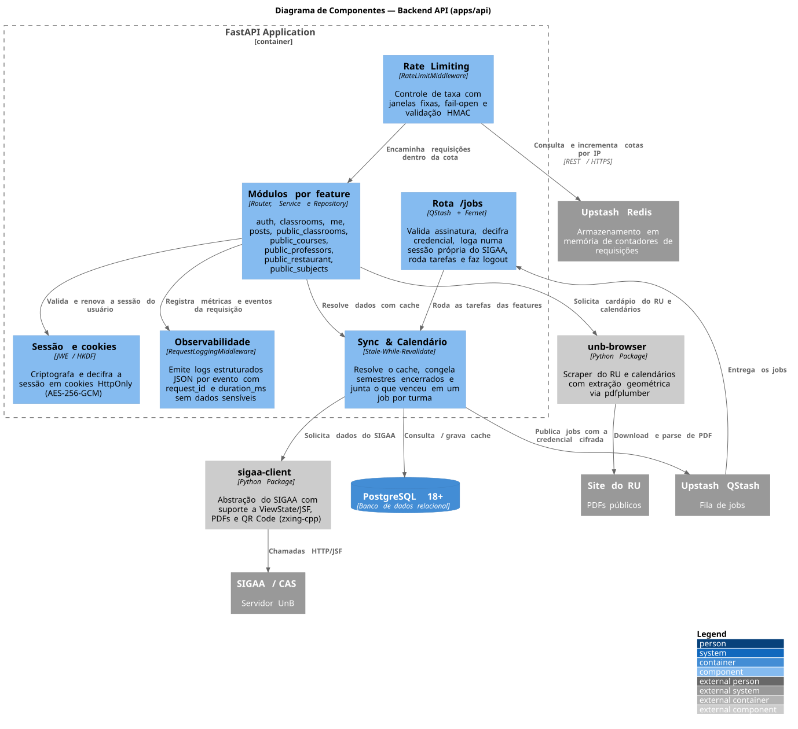

# Documento de Arquitetura — Followw UnB

## Introdução

### Finalidade
Este documento descreve a arquitetura de software do **Followw UnB**, apresentando uma visão abrangente do sistema por meio de múltiplos modelos arquiteturais (Modelo C4), padrões de projeto, decisões técnicas e organização do código.

### Escopo
O Followw UnB é um cliente alternativo e open-source para o ecossistema de sistemas acadêmicos da Universidade de Brasília (UnB), agregando em uma experiência unificada e performática dados do **SIGAA**, **Restaurante Universitário (RU)**, calendários e editais.

O sistema não possui contas proprietárias: a autenticação é delegada ao **Centro de Autenticação da UnB** e toda requisição para o SIGAA é *stateless*, com credenciais cifradas no cliente e sincronização assíncrona inteligente.

---

## Stack Tecnológica

| Camada / Função | Tecnologia | Justificativa |
| :--- | :--- | :--- |
| **Frontend Web** | TanStack Start (React 19 / Vite / Nitro) | SSR/SPA unificado, tipagem estrita de rotas com TanStack Router e cache de estado via TanStack Query. |
| **Estilização** | Tailwind CSS v4 | Estilização utilitária atômica e performática com tema customizado (`@theme`). |
| **API Client (Web)** | `openapi-fetch` + `openapi-react-query` | Consumo *type-safe* sincronizado diretamente com o schema OpenAPI da API FastAPI (`schema.gen.ts`). |
| **Offline & PWA** | `vite-plugin-pwa` (Workbox) + `idb-keyval` | Service Worker para precache de assets/HTML SSR e persistência do cache do TanStack Query no IndexedDB por 14 dias. |
| **Backend API** | FastAPI (Python >= 3.14) | Assíncrono nativo, alta performance, geração automática de documentação OpenAPI (Scalar) e injeção de dependências robusta. |
| **Scraper SIGAA** | `sigaa-client` (`httpx`, `bs4`, `lxml`, `pypdf`, `zxing-cpp`, `markdownify`) | Abstração que gerencia o ciclo de vida JSF (ViewState, postback), emissão de documentos PDF, leitura de QR Code/código de barras do RU e conversão de HTML para Markdown. |
| **Scraper Sites UnB**| `unb-browser` (`httpx`, `bs4`, `pdfplumber`) | Extração resiliente de cardápios do RU (parser geométrico via `pdfplumber`) e calendários acadêmicos. |
| **Banco de Dados** | PostgreSQL 18+ (SQLAlchemy assíncrono + `asyncpg`) | Armazenamento de cache de turmas, postagens, currículos, disciplinas, cardápios e participantes. |
| **Fila Assíncrona** | Upstash QStash | Execução desacoplada de jobs de sincronização via webhooks HTTP autenticados, com *flow control* e deduplicação. |
| **Segurança/Sessão**| JWE (`AES-256-GCM`) + Fernet + HKDF | Sessão *stateless*: tokens e credenciais residem em cookies `HttpOnly` cifrados (JWE) e jobs em payloads Fernet; nenhuma senha persistida no servidor. |
| **Observabilidade** | Logger JSON (`api/logger.py`) + PostHog (Web) | Telemetria de produto no cliente e logs estruturados por evento com `request_id` e `duration_ms` sem exposição de dados sensíveis. |
| **Infra & Qualidade**| Vercel (`gru1`), GitHub Actions, `uv`, `bun`, Ruff, Oxlint/Oxfmt | Hospedagem Serverless Multi-Service, resolução instantânea de dependências e pipeline de CI com lint e testes automatizados. |

---

## Diagramas da Arquitetura (Modelo C4)
Os diagramas de arquitetura adotam o padrão de **Diagrams as Code** via **C4-PlantUML**, versionados como código em [`docs/diagrams/`](diagrams/) e renderizados em formato vetorial SVG localmente através do script [`scripts/generate_diagrams.py`](../scripts/generate_diagrams.py).

### Diagrama de Contexto do Sistema (Nível 1)
Apresenta o Followw UnB no seu ambiente operacional, seus usuários e as integrações com os sistemas da universidade e serviços externos.



> Código-fonte: [`docs/diagrams/context.puml`](diagrams/context.puml)

---

### Diagrama de Containers (Nível 2)
Detalha as aplicações executáveis, armazenamento de dados e fronteiras de comunicação entre componentes e serviços.



> Código-fonte: [`docs/diagrams/container.puml`](diagrams/container.puml)

---

### Diagrama de Componentes (Nível 3)
Apresenta a organização interna dos componentes do Frontend (`apps/web`), do Backend (`apps/api`) e suas interações com as bibliotecas do monorepo e dados.

#### Componentes do Frontend


> Código-fonte: [`docs/diagrams/components_frontend.puml`](diagrams/components_frontend.puml)

#### Componentes do Backend


> Código-fonte: [`docs/diagrams/components_backend.puml`](diagrams/components_backend.puml)


---

## Padrões Arquiteturais e Decisões de Design

### Sessão Stateless Criptografada (JWE)
- **Zero-Storage de Senhas**: A API do Followw não persiste credenciais nem sessões em disco ou banco de dados.
- **Cookies HttpOnly JWE**: A sessão é dividida em dois cookies protegidos por criptografia autenticada (`AES-256-GCM`), com chaves distintas derivadas via HKDF a partir de `JWT_SECRET_KEY`:
  - `access_token` (40 min): Sessão JSF ativa do SIGAA.
  - `refresh_token` (14 dias): Matrícula e senha encriptadas para renovação automática de sessão sem atrito para o usuário.

### Estratégia de Cache: Stale-While-Revalidate (SWR)
- Chamadas a dados custosos do SIGAA utilizam o `Sync.resolve(tarefa, alvo, load)` (`api/sync/`).
- Se o dado em cache estiver válido, ele é servido imediatamente.
- Se estiver expirado (*stale*), os dados do cache são servidos instantaneamente e a tarefa de sincronização entra num job do **QStash**, publicado antes da resposta.
- Sem cache, a requisição busca no SIGAA na hora, com a sessão do próprio usuário.

### Isolamento dos Scrapers em Pacotes Monorepo
- O parsing das páginas da UnB é completamente desacoplado da API REST em dois pacotes (`packages/sigaa-client` e `packages/unb-browser`).
- **Resiliência a JSF**: O `sigaa-client` trata ciclos de vida de `ViewState`, postbacks de menus laterais (`jscookMenu`) e a turma aberta, que é estado da sessão: requisições paralelas na mesma sessão podem trocá-la, e o client confere e reabre a turma antes de ler cada tela.
- **Extração geométrica de PDFs**: O `unb-browser` utiliza `pdfplumber` avaliando posicionamento espacial relativo para lidar com células mescladas e formatos variados entre os campi da UnB.

### Orquestração de Background Jobs (QStash)
- Operações lentas de sincronização são desacopladas da requisição síncrona do usuário.
- **Sessão efêmera por job**: o job nunca usa a sessão do usuário. Ele leva a credencial cifrada (Fernet com chave própria derivada via HKDF), faz login numa sessão própria do SIGAA, roda as tarefas e faz logout no fim. Sessões diferentes da mesma conta não interferem entre si.
- **Um job por turma**: a requisição junta as tarefas vencidas e publica um job por turma (e um da conta, com perfil e lista de turmas). O sync do login abre um job para cada turma com telas vencidas.
- **Paralelismo**: o *flow control* por matrícula (`parallelism: 4`) só poupa o CAS de rajadas de login; os jobs não disputam sessão.
- **Falhas**: uma tarefa que falha na origem não impede as outras e ganha uma única retentativa, com 1 min de espera. Senha recusada descarta o job.

### Arquitetura Offline-First e PWA (Frontend)
- O cliente web funciona sem conexão à internet combinando duas camadas independentes em `apps/web/src/integrations/offline/` (detalhadas em [`docs/offline.md`](offline.md)):
  - **Service Worker (`vite-plugin-pwa` / Workbox)**: faz precache dos assets de build e armazena o HTML das navegações SSR em estratégia *network-first* (com timeout de 3 s) em cache versionado por build (`followw-pages-<build>`).
  - **Persistência do TanStack Query (`IndexedDB`)**: salva os dados retornados pela API por até **14 dias** (`idb-keyval`), restaurando-os após a hidratação e descartando o cache automaticamente quando o contrato da API muda (via hash SHA-256 de `schema.gen.ts`).

### Seed Estático de Dados Públicos e Regras do Calendário Acadêmico
- **Semeadura de Dados (`api/db/seed/`)**: na inicialização do banco (`db-init`), arquivos CSV pré-coletados em `packages/sigaa-client/data/` populam automaticamente unidades acadêmicas (`unities`), cursos de graduação (`courses`), estruturas curriculares (`curriculums`), componentes curriculares (`subjects`) e turmas (`classrooms`).
- **Congelamento por Calendário Acadêmico (`api/academic_calendar.py`)**: utiliza as datas oficiais do período letivo para congelar automaticamente a ressincronização de turmas encerradas (passados 3 dias do término do semestre, após um último sync consolidado), evitando requisições desnecessárias ao SIGAA em semestres passados.

### Observabilidade Estruturada e Privacidade por Design
- **Logs Estruturados (`api/logger.py`)**: a API emite eventos em formato JSON por linha em `stderr`, correlacionando todas as operações da requisição (`sigaa.connect`, `queue.publish`, `job`, `sync.task`) sob um mesmo `request_id` e registrando o tempo decorrido (`duration_ms`), conforme detalhado em [`docs/observability.md`](observability.md).
- **Allowlist Estrita de Campos**: o logger aceita apenas metadados operacionais pré-definidos, garantindo por construção que cookies, cabeçalhos, parâmetros de URL, senhas ou tracebacks com dados pessoais jamais sejam gravados nos logs.

---

## Estrutura de Diretórios do Projeto

```
.
├── apps/
│   ├── api/                        # Backend FastAPI
│   │   ├── api/
│   │   │   ├── core/               # Configurações e variáveis de ambiente
│   │   │   ├── db/                 # Modelos SQLAlchemy, inicialização e seed (unidades, cursos, currículos, turmas)
│   │   │   ├── modules/            # Uma pasta por feature: auth, classrooms, me, posts, public_*
│   │   │   ├── sync/               # Motor de cache (SWR), fila do QStash e rota /jobs
│   │   │   ├── academic_calendar.py# Regras de congelamento de sync e status pelo calendário acadêmico
│   │   │   ├── sigaa.py            # Conexão com o SIGAA da requisição
│   │   │   ├── cookies.py          # Cookies de sessão cifrados (JWE)
│   │   │   ├── cache.py            # Diretivas de Cache-Control
│   │   │   ├── errors.py           # Erros do SIGAA e do RU traduzidos para HTTP
│   │   │   └── logger.py           # Logs estruturados JSON e middleware de requisição
│   │   └── tests/                  # Testes da API, um arquivo por módulo
│   │
│   └── web/                        # Frontend TanStack Start
│       ├── src/
│       │   ├── components/         # Componentes React de interface
│       │   ├── integrations/       # Suporte offline (PWA/Workbox + IndexedDB), TanStack Query e PostHog
│       │   ├── lib/                # Utilitários de domínio, grade horária, status online/offline e downloads
│       │   ├── queries/            # Clientes de API (openapi-fetch, schema.gen.ts e queries tipadas)
│       │   └── routes/             # Rotas da aplicação (file-based routing: /, /turmas, /buscar, /ru, /perfil, /login)
│       └── tests/                  # Testes unitários e de componentes do frontend
│
├── packages/
│   ├── sigaa-client/               # Scraper assíncrono do SIGAA e datasets públicos (data/*.csv)
│   └── unb-browser/                # Scraper do RU e calendários acadêmicos
│
├── docs/                           # Documentação de arquitetura, cache, offline, observabilidade e sprints
│   ├── assets/                     # Diagramas renderizados em SVG e imagens
│   └── diagrams/                   # Diagramas como código em C4-PlantUML (.puml)
│
├── scripts/                        # Scripts utilitários locais (ex: geração de diagramas)
├── compose.yml                     # Configuração do PostgreSQL 18 local
└── vercel.json                     # Configuração Serverless Multi-Service (web + api) na Vercel
```
