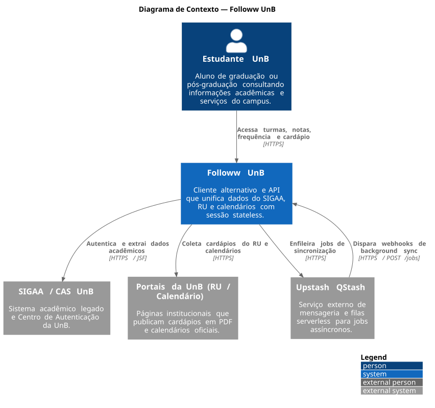
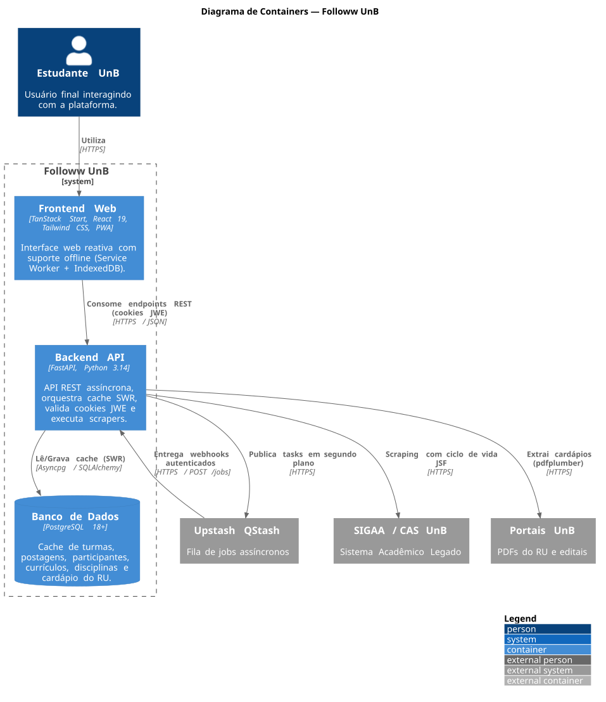
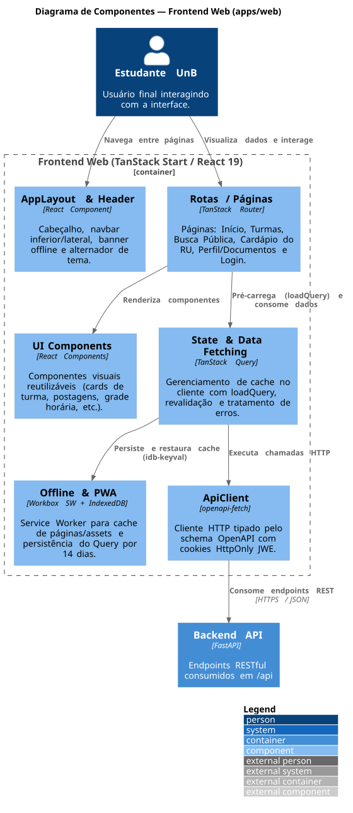
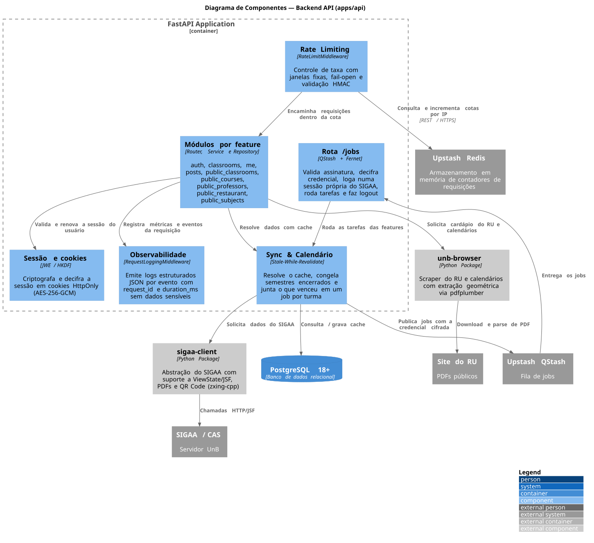

# Documento de Arquitetura — Followw UnB

## Introdução

### Finalidade

Este documento descreve a arquitetura de software do **Followw UnB**, apresentando uma visão
abrangente do sistema por meio de múltiplos modelos arquiteturais (Modelo C4), padrões de projeto,
decisões técnicas e organização do código.

### Escopo

O Followw UnB é um cliente alternativo e open-source para o ecossistema de sistemas acadêmicos da
Universidade de Brasília (UnB), agregando em uma experiência unificada e performática dados do
**SIGAA**, **Restaurante Universitário (RU)**, calendários e editais.

O sistema não possui contas proprietárias: a autenticação é delegada ao **Centro de Autenticação da
UnB** e toda requisição para o SIGAA é _stateless_, com credenciais cifradas no cliente e
sincronização assíncrona inteligente.

---

## Stack Tecnológica

| Camada / Função        | Tecnologia                                                                   | Justificativa                                                                                                                                                             |
| :--------------------- | :--------------------------------------------------------------------------- | :------------------------------------------------------------------------------------------------------------------------------------------------------------------------ |
| **Frontend Web**       | TanStack Start (React 19 / Vite / Nitro)                                     | SSR/SPA unificado, tipagem estrita de rotas com TanStack Router e cache de estado via TanStack Query.                                                                     |
| **Estilização**        | Tailwind CSS v4                                                              | Estilização utilitária atômica e performática com tema customizado (`@theme`).                                                                                            |
| **API Client (Web)**   | `openapi-fetch` + `openapi-react-query`                                      | Consumo _type-safe_ sincronizado diretamente com o schema OpenAPI da API FastAPI (`packages/core`, `schema.gen.ts`).                                                      |
| **Offline & PWA**      | `vite-plugin-pwa` (Workbox) + `idb-keyval`                                   | Service Worker para precache de assets/HTML SSR e persistência do cache do TanStack Query no IndexedDB por 14 dias.                                                       |
| **Backend API**        | FastAPI (Python >= 3.14)                                                     | Assíncrono nativo, alta performance, geração automática de documentação OpenAPI (Mintlify) e injeção de dependências robusta.                                             |
| **Scraper SIGAA**      | `sigaa-client` (`httpx`, `bs4`, `lxml`, `pypdf`, `zxing-cpp`, `markdownify`) | Abstração que gerencia o ciclo de vida JSF (ViewState, postback), emissão de documentos PDF, leitura de QR Code/código de barras do RU e conversão de HTML para Markdown. |
| **Scraper Sites UnB**  | `unb-browser` (`httpx`, `bs4`, `pdfplumber`)                                 | Extração resiliente de cardápios do RU (parser geométrico via `pdfplumber`) e calendários acadêmicos.                                                                     |
| **Banco de Dados**     | PostgreSQL 18+ (SQLAlchemy assíncrono + `asyncpg`)                           | Armazenamento de cache de turmas, postagens, currículos, disciplinas, cardápios e participantes.                                                                          |
| **Rate Limit / Cache** | Upstash Redis (REST HTTP) / Redis 8 (`redis-py`)                             | Controle de taxa em memória por IP/janela fixa, mitigando abusos de força bruta e sobrecarga no CAS/SIGAA.                                                                |
| **Fila Assíncrona**    | Upstash QStash                                                               | Execução desacoplada de jobs de sincronização via webhooks HTTP autenticados, com _flow control_ e deduplicação.                                                          |
| **Segurança/Sessão**   | JWE (`AES-256-GCM`) + Fernet + HKDF                                          | Sessão _stateless_: tokens e credenciais residem em cookies `HttpOnly` cifrados (JWE) e jobs em payloads Fernet; nenhuma senha persistida no servidor.                    |
| **Observabilidade**    | Logger JSON (`api/logger.py`) + PostHog (Web)                                | Telemetria de produto no cliente e logs estruturados por evento com `request_id` e `duration_ms` sem exposição de dados sensíveis.                                        |
| **Infra & Qualidade**  | Vercel (`gru1`), GitHub Actions, `uv`, `bun`, Ruff, Oxlint/Oxfmt             | Hospedagem Serverless Multi-Service, resolução instantânea de dependências e pipeline de CI com lint e testes automatizados.                                              |

---

## Diagramas da Arquitetura (Modelo C4)

Os diagramas de arquitetura adotam o padrão de **Diagrams as Code** via **C4-PlantUML**, versionados
como código em [`docs/diagrams/`](https://github.com/unb-mds/2026-2-Followw/tree/main/docs/diagrams)
e renderizados em formato vetorial SVG localmente através do script
[`scripts/generate_diagrams.py`](https://github.com/unb-mds/2026-2-Followw/blob/main/scripts/generate_diagrams.py).

### Diagrama de Contexto do Sistema (Nível 1)

Apresenta o Followw UnB no seu ambiente operacional, seus usuários e as integrações com os sistemas
da universidade e serviços externos.



> Código-fonte:
> [`docs/diagrams/context.puml`](https://github.com/unb-mds/2026-2-Followw/blob/main/docs/diagrams/context.puml)

---

### Diagrama de Containers (Nível 2)

Detalha as aplicações executáveis, armazenamento de dados e fronteiras de comunicação entre
componentes e serviços.



> Código-fonte:
> [`docs/diagrams/container.puml`](https://github.com/unb-mds/2026-2-Followw/blob/main/docs/diagrams/container.puml)

---

### Diagrama de Componentes (Nível 3)

Apresenta a organização interna dos componentes do Frontend (`apps/web`), do Backend (`apps/api`) e
suas interações com as bibliotecas do monorepo e dados.

#### Componentes do Frontend



> Código-fonte:
> [`docs/diagrams/components_frontend.puml`](https://github.com/unb-mds/2026-2-Followw/blob/main/docs/diagrams/components_frontend.puml)

#### Componentes do Backend



> Código-fonte:
> [`docs/diagrams/components_backend.puml`](https://github.com/unb-mds/2026-2-Followw/blob/main/docs/diagrams/components_backend.puml)

---

## Padrões Arquiteturais e Decisões de Design

### Sessão Stateless Criptografada (JWE)

- **Zero-Storage de Senhas**: A API do Followw não persiste credenciais nem sessões em disco ou
  banco de dados.
- **Cookies HttpOnly JWE**: A sessão é dividida em dois cookies protegidos por criptografia
  autenticada (`AES-256-GCM`), com chaves distintas derivadas via HKDF a partir de `JWT_SECRET_KEY`:
    - `access_token` (40 min): Sessão JSF ativa do SIGAA.
    - `refresh_token` (14 dias): Matrícula e senha encriptadas para renovação automática de sessão
      sem atrito para o usuário.
- Para detalhes sobre ciclo de vida dos tokens, rotação de chaves e garantias criptográficas,
  disponível em [`docs/segurança.md`](segurança.md).

### Proteção contra Abuso e Rate Limiting (Redis)

- **Controle de Taxa Distribuído (`api/rate_limit.py`, `api/redis.py`)**: A API aplica limites de
  requisição em memória via Upstash Redis (REST HTTP em produção e Redis 8 localmente) para conter
  abusos e mitigar ataques de força bruta contra o CAS/SIGAA da UnB.
- **Privacidade e Tolerância a Falhas**: Chaves de limitação usam hashes criptográficos anonimizados
  do IP (sem dados pessoais ou cookies gravados no Redis) e operam em modelo tolerante a falhas
  (_fail-open_), garantindo que indisponibilidades do Redis não interrompam o acesso dos alunos.
- Para cotas de requisição, encaminhamento seguro de IP no SSR e configurações operacionais,
  disponível em [`docs/rate-limit.md`](rate-limit.md).

### Estratégia de Cache: Stale-While-Revalidate (SWR)

- Chamadas a dados custosos do SIGAA utilizam o `Sync.resolve(tarefa, alvo, load)` (`api/sync/`):
  dados válidos são servidos instantaneamente; dados expirados (_stale_) são servidos de imediato
  enquanto uma revalidação assíncrona é enfileirada no QStash; e requisições sem cache consultam o
  SIGAA diretamente com a sessão ativa.
- Para a matriz completa de TTLs, diretivas `Cache-Control` do cliente e regras de sincronização,
  disponível em [`docs/cache-e-sincronizacao.md`](cache-e-sincronizacao.md).

### Isolamento dos Scrapers em Pacotes Monorepo

- O parsing das páginas da UnB é completamente desacoplado da API REST em dois pacotes
  (`packages/sigaa-client` e `packages/unb-browser`).
- **Resiliência a JSF**: O `sigaa-client` trata ciclos de vida de `ViewState`, postbacks de menus
  laterais (`jscookMenu`) e a turma aberta, que é estado da sessão: requisições paralelas na mesma
  sessão podem trocá-la, e o client confere e reabre a turma antes de ler cada tela.
- **Extração geométrica de PDFs**: O `unb-browser` utiliza `pdfplumber` avaliando posicionamento
  espacial relativo para lidar com células mescladas e formatos variados entre os campi da UnB.

### Orquestração de Background Jobs (QStash)

- **Sessões Efêmeras e Desacoplamento**: Operações lentas de sincronização rodam em segundo plano
  via Upstash QStash. Cada job transporta a credencial cifrada em Fernet, autentica em sessão
  própria e efêmera no SIGAA, executa as tarefas agendadas e encerra a sessão, sem interferir na
  navegação do usuário.
- Para detalhes de controle de fluxo (`parallelism`), retentativas e agendamento por turma,
  disponível em [`docs/cache-e-sincronizacao.md`](cache-e-sincronizacao.md).

### Arquitetura Offline-First e PWA (Frontend)

- O frontend opera sem internet combinando duas camadas (`apps/web/src/integrations/offline/`): o
  **Service Worker** (`vite-plugin-pwa` / Workbox) para precache de assets estáticos e navegação SSR
  (_network-first_), e a persistência do **TanStack Query** no IndexedDB (`idb-keyval`) para manter
  dados acadêmicos salvos localmente com invalidação automática quando o contrato da API muda.
- Para ciclo de vida do Service Worker, estratégias de fallback de rotas e testes offline,
  disponível em [`docs/offline.md`](offline.md).

### Seed Estático de Dados Públicos e Regras do Calendário Acadêmico

- **Semeadura de Dados (`api/db/seed/`)**: na inicialização do banco (`db-init`), arquivos CSV
  pré-coletados em `packages/sigaa-client/data/` populam automaticamente unidades acadêmicas
  (`units`), cursos de graduação (`courses`), estruturas curriculares (`curriculums`), componentes
  curriculares (`subjects`) e turmas (`classrooms`).
- **Congelamento por Calendário Acadêmico (`api/academic_calendar.py`)**: utiliza as datas oficiais
  do período letivo para congelar automaticamente a ressincronização de turmas encerradas (passados
  3 dias do término do semestre, após um último sync consolidado), evitando requisições
  desnecessárias ao SIGAA em semestres passados.

### Observabilidade Estruturada e Privacidade por Design

- **Logs Estruturados (`api/logger.py`)**: A API emite eventos em formato JSON por linha em
  `stderr`, correlacionando todo o ciclo de vida das operações sob um identificador único
  (`request_id`) com medição de tempo (`duration_ms`).
- **Privacidade por Construção**: Uma allowlist estrita aceita exclusivamente metadados operacionais
  pré-definidos, impedindo que credenciais, cookies, parâmetros de URL ou tracebacks com dados
  pessoais sejam logados.
- Para o catálogo de eventos operacionais e especificações de monitoramento, disponível em
  [`docs/observability.md`](observability.md).

---

## Estrutura de Diretórios do Projeto

```
.
├── apps/
│   ├── api/                        # Backend FastAPI
│   │   ├── api/
│   │   │   ├── core/               # Configurações e variáveis de ambiente
│   │   │   ├── db/                 # Modelos SQLAlchemy, inicialização e seed (unidades, cursos, currículos, turmas)
│   │   │   ├── modules/            # Uma pasta por feature: auth, classrooms, me, posts, public_*
│   │   │   ├── sync/               # Motor de cache (SWR), fila do QStash e rota /jobs
│   │   │   ├── academic_calendar.py# Regras de congelamento de sync e status pelo calendário acadêmico
│   │   │   ├── cache.py            # Diretivas de Cache-Control
│   │   │   ├── cookies.py          # Cookies de sessão cifrados (JWE)
│   │   │   ├── errors.py           # Erros do SIGAA e do RU traduzidos para HTTP
│   │   │   ├── logger.py           # Logs estruturados JSON e middleware de requisição
│   │   │   ├── main.py             # Ponto de entrada FastAPI, middlewares e registro de rotas
│   │   │   ├── rate_limit.py       # Middleware de limitação de taxa por janela fixa
│   │   │   ├── redis.py            # Cliente Upstash Redis assíncrono
│   │   │   ├── schemas.py          # Esquemas Pydantic compartilhados
│   │   │   └── sigaa.py            # Conexão com o SIGAA da requisição
│   │   └── tests/                  # Testes da API, um arquivo por módulo
│   │
│   └── web/                        # Frontend TanStack Start
│       ├── src/
│       │   ├── components/         # Componentes React de interface
│       │   ├── integrations/       # Suporte offline (PWA/Workbox + IndexedDB), TanStack Query e PostHog
│       │   ├── lib/                # Utilitários de plataforma: armazenamento, tema, status online/offline e downloads
│       │   ├── queries/            # Middleware SSR do cliente de API, autenticação e downloads
│       │   └── routes/             # Rotas da aplicação (file-based routing: /, /turmas, /buscar, /ru, /perfil, /login, /privacidade)
│       └── tests/                  # Testes unitários e de componentes do frontend
│
├── packages/
│   ├── core/                       # TypeScript compartilhado (web e futuro mobile): cliente OpenAPI, schema.gen.ts, queries e lógica de domínio
│   ├── sigaa-client/               # Scraper assíncrono do SIGAA e datasets públicos (data/*.csv)
│   └── unb-browser/                # Scraper do RU e calendários acadêmicos
│
├── docs/                           # Documentação de arquitetura, cache, offline, rate limit, observabilidade e sprints
│   ├── assets/                     # Diagramas renderizados em SVG e imagens
│   └── diagrams/                   # Diagramas como código em C4-PlantUML (.puml)
│
├── scripts/                        # Scripts utilitários locais (ex: geração de diagramas)
├── compose.yml                     # Configuração local do PostgreSQL 18, Redis 8 e QStash Dev
└── vercel.json                     # Configuração Serverless Multi-Service (web + api) na Vercel
```
